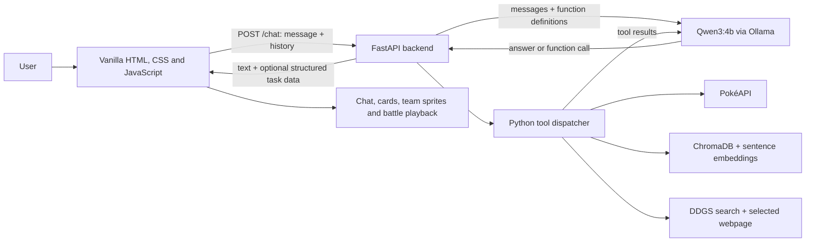

# Poké AI

Poké AI is a Pokémon-focused conversational assistant with a browser chat interface, a FastAPI backend, and a local generative model served by Ollama. It uses an **agentic tool-calling** pattern: the model interprets each request, chooses from available functions, receives their results, and then generates an answer grounded in those results.

The project is designed to combine different kinds of work rather than ask a language model to do everything from memory:

- **Generative AI** understands natural-language requests, resolves references from the conversation, decides which functions can help, and explains results.
- **Deterministic Python code** retrieves Pokémon records, computes type coverage and move damage, assembles response data, and validates task output.
- **External and local data sources** provide factual material for the model to use.
- **The browser** renders the answer and any structured cards, team sprites, or battle controls returned by the backend.

This README describes the implemented project, including the distinction between the three main task pipelines and other callable capabilities.

## Contents

- [Project architecture](#project-architecture)
- [Agent and tool model](#agent-and-tool-model)
- [Task pipelines](#task-pipelines)
  - [Pokémon facts and PokéAPI](#1-pokémon-facts-and-pokeapi)
  - [Team builder](#2-team-builder)
  - [Battle simulator](#3-battle-simulator)
- [Other information sources](#other-information-sources)
- [HTTP API](#http-api)
- [Frontend behavior](#frontend-behavior)
- [Repository map](#repository-map)
- [Run locally](#run-locally)
- [Testing and smoke checks](#testing-and-smoke-checks)
- [Limitations and design notes](#limitations-and-design-notes)

## Project architecture



### Request lifecycle

1. The browser submits the user's message and the conversation history it has kept in memory to `POST /chat`.
2. FastAPI assembles the system instructions, prior turns, and new message, then asks the configured model (`qwen3:4b`) for a response with the registered functions available.
3. The response may be ordinary text or one or more function calls. The backend dispatches each function by name and appends its result to the conversation supplied to the model.
4. The model may request another round of functions. The backend repeats the tool loop until the model returns a response without more function calls.
5. A final synthesis step generates the user-facing text. Special instructions keep team recommendations aligned with the analyzed core and constrain battle responses to a short introduction.
6. The backend returns the text plus optional structured data. The browser renders the message and, where applicable, a Pokémon image, a team, or battle controls.

This is agentic in the practical sense that **the model chooses and can sequence functions in response to the request**. It is not an unconstrained autonomous process: Python owns function execution and the deterministic calculations, and the request only completes when the backend has a final response or an error.

### Highlighting tool names

Tool names are shown using highlighted inline code, for example <mark><code>get_pokemon</code></mark>. Each function name is an identifier used by the model and backend; the adjacent prose describes what that function does in this project.

## Agent and tool model

The backend registers the following functions for model tool calling:

| Tool | One-line description |
|---|---|
| <mark><code>get_pokemon</code></mark> | Resolve a Pokémon name and return structured facts from PokéAPI. |
| <mark><code>analyze_team_coverage</code></mark> | Analyze the user's selected roster for defensive weaknesses and offensive type coverage. |
| <mark><code>simulate_battle</code></mark> | Prepare two Pokémon's sprites, moves, stats, and estimated damage for the battle UI. |
| <mark><code>search_knowledge</code></mark> | Retrieve the most relevant passages from the local Pokémon knowledge collection. |
| <mark><code>web_search</code></mark> | Search the web for information that is current or not covered by local sources. |
| <mark><code>fetch_web_page</code></mark> | Fetch a webpage and extract a bounded amount of readable text. |

These are the same six tools shown in the frontend's architecture overview.

Tool selection is driven by the system instructions and each function's description. In broad terms:

- Pokémon facts and artwork route to PokéAPI-backed functions.
- Team building routes to <mark><code>analyze_team_coverage</code></mark>, with only user-selected Pokémon passed as the initial core.
- A requested matchup routes to <mark><code>simulate_battle</code></mark>.
- Local lore can route to <mark><code>search_knowledge</code></mark>.
- Current or external questions can route to <mark><code>web_search</code></mark>, followed by <mark><code>fetch_web_page</code></mark> for a selected result.

Function results are appended to the model conversation as tool context. Some structured data is also retained separately by the backend so it can be returned to the browser without asking the model to reproduce large payloads.

## Task pipelines

### 1. Pokémon facts and PokéAPI

This path is for factual questions about individual Pokémon, such as types, abilities, measurements, and base stats.

1. **Interpret the request.** The model uses the conversation to identify the Pokémon and the requested facts.
2. **Request structured data.** It calls <mark><code>get_pokemon</code></mark> with a Pokémon name or form.
3. **Resolve the name.** Python normalizes the name and checks it against the PokéAPI Pokémon index. Exact normalized matches are tried first; a fuzzy match is used as a fallback.
4. **Fetch and shape the record.** The backend requests the Pokémon resource from PokéAPI and extracts the canonical name, height, weight, types, abilities, base stats, official artwork, and Showdown sprite URLs.
5. **Ground the answer.** The structured result is returned to the model. The system instructions tell it to treat retrieved Pokémon facts as authoritative and to answer the user's actual question.
6. **Render the result.** If the tool result is categorized as `pokemon_data`, the API includes the official artwork URL in its response. The frontend renders the model's answer and the artwork.

The backend retries selected transient PokéAPI failures, and Pokémon names/move details use in-process caches where configured. A failed or unresolved lookup does not provide invented structured data.

### 2. Team builder

The team builder combines **deterministic coverage analysis** with **generative recommendations**. The model is expected to keep the user's selected Pokémon and suggest additions rather than silently replacing the user's choices.

1. **Identify the starting core.** The model resolves the user's explicitly selected Pokémon from the current request and conversation history.
2. **Analyze only that core.** It calls <mark><code>analyze_team_coverage</code></mark> with those selected Pokémon. Proposed additions are not passed in as if the user had selected them.
3. **Fetch member data.** The analyzer resolves each Pokémon through the same PokéAPI-backed lookup logic used for structured Pokémon data.
4. **Calculate coverage.** Python applies the type-effectiveness chart to find attack types that threaten at least one team member, useful defensive resistances or immunities, and offensive types not represented in the selected team's type coverage.
5. **Generate recommendations.** The coverage results are returned to the model. A task-specific final instruction tells it to preserve the selected core and recommend exactly enough distinct Pokémon to fill the roster to six, while explaining how additions complement the team.
6. **Resolve the displayed roster.** If the team is not full, the backend makes a separate model call to extract the recommended Pokémon names from the generated answer. It resolves each name to canonical Pokémon data and selects a Showdown sprite, falling back to official artwork when needed.
7. **Validate and render.** The API expects six displayable team members. If it cannot assemble all six or a sprite is missing, it returns an error instead of a success-shaped partial roster. Otherwise, it returns `type: "team_analysis"` and `team_sprites`; the browser displays the answer and sprite grid.

The key tool in the analysis stage is <mark><code>analyze_team_coverage</code></mark>. The follow-up name extraction and Pokémon lookups are additional backend work used to build the visual roster; they are not separate model-callable tools.

### 3. Battle simulator

The battle pipeline prepares a matchup from retrieved data, then plays a deliberately simplified animation in the browser. It is **not** a full implementation of the Pokémon battle rules.

1. **Identify both Pokémon.** The model resolves the two requested names and calls <mark><code>simulate_battle</code></mark>.
2. **Fetch base records and sprites.** Python resolves both Pokémon through PokéAPI-backed lookups, then fetches their battle sprites.
3. **Inspect learned moves.** For each Pokémon, the backend fetches its learnset and examines at most the first 25 listed moves. It retrieves move details, skips status moves without base power, and computes damage against the opponent.
4. **Estimate damage.** Damage uses a level-50-style formula, the attack or special-attack stat appropriate to the move class, STAB, the project's type-effectiveness chart, and a fixed neutral variance multiplier. The backend chooses up to four high-damage moves, preferring different move types when possible.
5. **Return structured battle data.** The `battle_simulation` response includes both players' names, calculated maximum HP, sprites, and moves with their precomputed damage. The model's displayed text is constrained to a short matchup introduction.
6. **Play in the browser.** When the user presses **Start battle**, the frontend applies each side's strongest precomputed damage simultaneously every 1.5 seconds, updates HP bars, and announces a winner or a draw when one or both Pokémon reach zero HP.

The backend preparation tool is <mark><code>simulate_battle</code></mark>. The turn-like playback is JavaScript in the frontend: it does not ask the model to choose a move each turn, and it does not model every mechanic such as move accuracy, abilities, items, status conditions, or speed order.

## Other information sources

Not every question fits one of the three task pipelines. The agent can retrieve local or external context when appropriate.

### Local Pokémon knowledge

- `knowledge_base.py` creates or opens the persistent ChromaDB collection named `pokemon_knowledge`, embeds a small set of starter documents, and upserts them into the collection.
- `rag_tools.py` loads the same persistent collection and the `all-MiniLM-L6-v2` sentence-transformer embedding model.
- When selected, <mark><code>search_knowledge</code></mark> embeds the user's question, queries ChromaDB for the two nearest documents, and returns their text as context to the model.
- The bundled starter content is intentionally small. The mechanism is retrieval-augmented generation (RAG), not a complete Pokémon encyclopedia.

The API currently opens the collection with `get_collection`, so the collection must already exist before the API imports `rag_tools`. On a fresh local setup, initialize the knowledge base before starting the API.

### Internet search and webpage retrieval

- <mark><code>web_search</code></mark> uses DDGS to retrieve up to five results containing titles, URLs, and snippets.
- For a search request, the backend asks the model to select the most relevant result URL, then fetches that page and returns its extracted text together with the search results.
- <mark><code>fetch_web_page</code></mark> is also available for a direct URL request. The page reader strips common non-content elements such as scripts, styles, navigation, headers, and footers, then limits extracted text to 12,000 characters.
- Search and webpage content are source material for a synthesized answer, not guaranteed to be complete or authoritative.

### Sprite proxy

The separate `GET /sprite` endpoint proxies approved Pokémon sprite URLs from `raw.githubusercontent.com`. It validates the host and sprite path, rejects unsupported URLs, checks that the upstream response is an image, and caches successful responses in-process. The frontend uses this for PokeAPI-hosted Showdown sprite images when rendering them.

## HTTP API

### `GET /`

Serves `frontend/index.html`. The page loads the static frontend assets from `/static`.

### `POST /chat`

Accepts a JSON body with a message and optional prior conversation turns:

```json
{
  "message": "Tell me about Pikachu",
  "history": [
    {
      "role": "user",
      "content": "I like Electric-type Pokémon."
    },
    {
      "role": "assistant",
      "content": "Electric types are a fun place to start."
    }
  ]
}
```

The normal response always includes a text `response`. It also includes a `type` and task-specific fields when the agent executed a recognized task:

| Response type | Additional field(s) | Frontend rendering |
|---|---|---|
| `standard_chat` | None | Formatted assistant text |
| `pokemon_data` | `image_url` | Assistant text and official artwork |
| `team_analysis` | `team_sprites` | Assistant text and a grid of team sprites |
| `battle_simulation` | `battle_data` | Assistant text and interactive battle card |

Representative task-specific shapes:

```json
{
  "response": "Pikachu is an Electric-type Pokémon...",
  "type": "pokemon_data",
  "image_url": "https://example.invalid/pikachu.png"
}
```

```json
{
  "response": "Here is a balanced team...",
  "type": "team_analysis",
  "team_sprites": [
    {
      "name": "pikachu",
      "showdown_sprite": "<sprite-url>"
    },
    {
      "name": "team-member-2",
      "showdown_sprite": "<sprite-url>"
    },
    {
      "name": "team-member-3",
      "showdown_sprite": "<sprite-url>"
    },
    {
      "name": "team-member-4",
      "showdown_sprite": "<sprite-url>"
    },
    {
      "name": "team-member-5",
      "showdown_sprite": "<sprite-url>"
    },
    {
      "name": "team-member-6",
      "showdown_sprite": "<sprite-url>"
    }
  ]
}
```

```json
{
  "response": "Here is a battle simulation between Pikachu and Squirtle!",
  "type": "battle_simulation",
  "battle_data": {
    "player_one": {
      "name": "pikachu",
      "max_hp": 220,
      "back_sprite": "https://example.invalid/pikachu-back.gif",
      "moves": []
    },
    "player_two": {
      "name": "squirtle",
      "max_hp": 220,
      "front_sprite": "https://example.invalid/squirtle-front.gif",
      "moves": []
    }
  }
}
```

The example URLs and numeric values above illustrate field shapes only; they are not live output values.

### `GET /sprite`

Accepts a `url` query parameter for an approved Showdown sprite URL and returns the image bytes. Unsupported hosts or paths are rejected.

## Frontend behavior

The frontend is plain HTML, CSS, and JavaScript; there is no JavaScript bundler or client framework.

- `frontend/index.html` provides the chat layout, suggested prompts, and the architecture modal.
- `frontend/styles.css` contains the Poké Ball-inspired red, yellow, blue, and cream theme, responsive layout, cards, and modal styling.
- `frontend/script.js` submits chat requests, keeps history for the current page session, renders assistant text and task-specific cards, and animates the battle.
- Assistant Markdown is rendered with a small custom renderer that builds DOM nodes rather than inserting model output as raw HTML.
- While `/chat` is pending, the browser shows a thinking message and animated assistant avatar. The pending message is removed when a result or error arrives.
- The **How it works** modal describes the architecture and is scrollable as a whole; its contents do not use fixed navigation.

The chat history is held in the browser's JavaScript memory and sent with subsequent requests. It is not persisted to a user account or server-side conversation store by this frontend.

## Repository map

| Path | Responsibility |
|---|---|
| `api.py` | FastAPI app, static frontend serving, request handling, model/tool loop, response assembly, and sprite proxy |
| `pokemon_tools.py` | PokéAPI name resolution and lookups, team coverage analysis, move scoring, and battle preparation |
| `pokemon_chat.py` | Earlier/standalone CLI-oriented Pokémon assistant flow |
| `rag_tools.py` | Local embedding and ChromaDB similarity search used by the API |
| `knowledge_base.py` | Creates/seeds the local ChromaDB Pokémon knowledge collection |
| `web_search.py` | DDGS-powered web search |
| `web_page.py` | Webpage fetch and readable-text extraction |
| `rag_chat.py` | Standalone interactive local knowledge-base query script |
| `frontend/index.html` | Chat and architecture-modal markup |
| `frontend/styles.css` | Frontend theme, responsive styles, and animations |
| `frontend/script.js` | Chat requests and rendering for text, Pokémon data, teams, and battles |
| `requirements.txt` | Python dependency pins |
| `test_*.py` | Standalone connectivity and tool smoke scripts |

## Run locally

### Prerequisites

- Python and `pip`, using a Python release supported by the pinned packages in `requirements.txt`.
- [Ollama](https://ollama.com/) installed and available on the machine.
- The `qwen3:4b` model pulled into Ollama.
- Network access for PokéAPI and, when needed, web search and webpage retrieval.

### 1. Create and activate a virtual environment

From the repository root in PowerShell:

```powershell
py -m venv .venv
.\.venv\Scripts\Activate.ps1
python -m pip install --upgrade pip
pip install -r requirements.txt
```

If PowerShell blocks activation, use the appropriate execution-policy setting for your environment or invoke the virtual environment's Python directly at `.venv\Scripts\python.exe`.

### 2. Prepare the local knowledge base

Run this once from the repository root before starting the API if the `pokemon_knowledge` ChromaDB collection has not been created:

```powershell
python knowledge_base.py
```

This downloads/loads the sentence-transformer embedding model on first use and writes the seed collection under `chroma_db`.

### 3. Start Ollama and pull the model

Ensure the Ollama service is running, then run:

```powershell
ollama pull qwen3:4b
```

The application calls Ollama's local Python client with `model="qwen3:4b"`. No hosted model key is configured in this code.

### 4. Start the web app

From the repository root:

```powershell
python -m uvicorn api:app --reload
```

Open the local URL printed by Uvicorn (by default, `http://127.0.0.1:8000`). The FastAPI app serves both the frontend and its API, so no separate frontend development server is required.

### External services and first-run downloads

- Pokémon records and move resources come from PokéAPI.
- Web search uses DDGS; page content is fetched directly from the selected website.
- The local semantic search uses ChromaDB and the `all-MiniLM-L6-v2` embedding model.
- Ollama runs the `qwen3:4b` generation model locally.
- `knowledge_base.py` and the first use of `rag_tools.py` may download model assets. These downloads require network access and local disk space.

## Testing and smoke checks

The `test_*.py` files in this repository are standalone scripts rather than a single configured test suite. They can contact live services, require Ollama or local ChromaDB data, or print output instead of asserting results.

Examples:

```powershell
python test_pokeapi.py
python test_ollama.py
python test_rag.py
python test_tools.py
```

Run the scripts from the repository root so relative paths such as `./chroma_db` resolve as expected. Some scripts are interactive; for example, `test_rag.py` accepts questions until you enter `exit`.

## Limitations and design notes

- **Model output is probabilistic.** Retrieved records and deterministic calculations improve factual grounding but do not guarantee flawless natural-language explanations.
- **Coverage is an analysis signal.** The team builder uses a type chart to identify defensive weaknesses and uncovered offensive types; it does not run a full competitive teambuilder or validate every game-specific constraint.
- **Team completion requires six displayable sprites.** The API currently treats inability to assemble a full six-member visual roster as an error.
- **Battle playback is intentionally simplified.** Damage estimates are precomputed, both fighters deal their strongest move damage at the same time, and the browser repeats this at a fixed interval.
- **The local knowledge collection is small by default.** The seed documents demonstrate the retrieval pattern; the content should be expanded for broader coverage.
- **Search results can vary.** Web results and pages depend on network availability and external site content.
- **Process-local caches are temporary.** Pokémon/move data and sprite responses may be cached while a server process runs; they are not a durable shared cache.
- **The project is a local application.** The frontend's in-memory chat history and the API's current request handling are not a complete multi-user persistence or authentication system.
